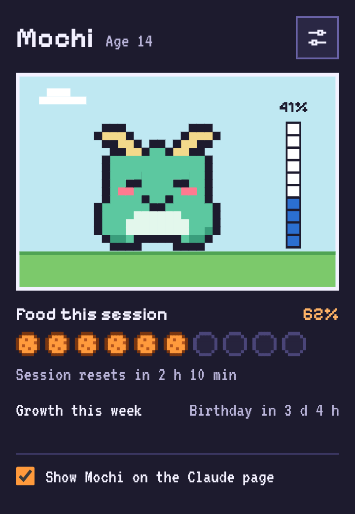

# Pixiu

A Chrome extension that shows your Claude plan usage as a Tamagotchi-style virtual pet. The design handoff is in [docs/](docs/README.md).



## Status

Version 0.1.0: all of version one in [docs/PLAN.md](docs/PLAN.md), plus the on-page overlay. The extension reads usage in the background, runs the pet engine on every read, and shows the pet in the popup and on the toolbar icon, with a badge. The pet also sits in a small window in the corner of claude.ai: hover it for its numbers, drag it to move it, and hide it from its card or from the switch in the popup.

Known limits: an account with no session limit never hatches its egg, and Claude's usage address is undocumented, so a change on Claude's side can stop Pixiu from reading it until an update.

To see states that take weeks to reach, use the debug page. It runs the engine against a pretend Claude and a pretend clock, and shows the popup and the toolbar icon for the pretend pet. Release builds leave it out: run `pnpm build:debug`, load `.output/chrome-mv3-debug` as a second extension, open the popup's settings, and choose "Debug page". That second extension has its own storage, so it raises its own pet.

Removing the extension deletes the pet, because Chrome deletes the extension's storage. Reloading it does not. Before removing it, open the popup's settings, choose "Back up or restore", and export the pet to a file. Import that file afterward.

## Install

Pixiu is not on the Chrome Web Store. You load it yourself, in Chrome or another Chromium browser.

1. Download `pixiu-<version>-chrome.zip` from the [latest release](https://github.com/nayed/pixiu/releases/latest) and unzip it into a folder you will keep. Chrome loads the extension from that folder every time it starts.
2. Open `chrome://extensions` and turn on "Developer mode".
3. Choose "Load unpacked" and select the unzipped folder.
4. Pin Pixiu to the toolbar. It starts as an egg.
5. Open [claude.ai](https://claude.ai) once while signed in, so Pixiu can find your account. After that it needs no Claude tab.

Then use Claude as usual, from any app. The egg warms as you use it and hatches once you have used about 10% of a session.

To update, export your pet first (popup settings, "Back up or restore"), replace the folder's contents with the new version, and press the reload button on Pixiu's card in `chrome://extensions`. Reloading keeps the pet. Removing the extension deletes it, which is what the export is for.

Pixiu reads two numbers from your claude.ai account, the session and weekly usage percentages, and keeps everything in the browser. It sends nothing anywhere else. It reads them every five minutes, and every 30 seconds while a claude.ai tab is in front and you have used it in the last five minutes, so the pet on the page eats soon after you do. Reading usage does not use any of your plan.

## Develop

Needs Node and pnpm.

```bash
pnpm install
pnpm build
```

Then load `.output/chrome-mv3` as in steps 2 to 5 above.

| Command            | What it does                                                           |
| ------------------ | ---------------------------------------------------------------------- |
| `pnpm dev`         | Builds on change and reloads the extension in a fresh browser profile. |
| `pnpm build`       | Release build into `.output/chrome-mv3`, without the debug page.       |
| `pnpm build:debug` | The same build with the debug page, into `.output/chrome-mv3-debug`.   |
| `pnpm zip`         | Release build, zipped for the Chrome Web Store.                        |
| `pnpm test`        | Unit tests.                                                            |
| `pnpm typecheck`   | Type check.                                                            |
| `pnpm lint`        | Lint and format check. `pnpm format` fixes what it can.                |

## Continuous integration and releases

GitHub Actions runs the typecheck, lint, tests, and both builds on every push to `main` and on every pull request.

To release, bump `version` in `package.json`, commit, then tag and push:

```bash
git tag -a v0.2.0 -m "Pixiu 0.2.0"
git push origin v0.2.0
```

The release workflow checks that the tag matches `package.json`, runs the checks, builds the zip, and makes a draft release with the zip attached and notes generated from the commits. Edit the notes on GitHub, then publish the draft.

## Layout

| Path                                    | What it holds                                                                        |
| --------------------------------------- | ------------------------------------------------------------------------------------ |
| `src/entrypoints/background.ts`         | The background worker. Polls usage, runs the engine, and saves the pet.              |
| `src/entrypoints/content.ts`            | Runs on claude.ai. Learns the organization ID and puts the overlay on the page.      |
| `src/entrypoints/overlay/`              | The overlay page, shown in a frame on claude.ai.                                     |
| `src/lib/overlay/`                      | The frame that holds the overlay, and when to read usage while claude.ai is in use.  |
| `src/entrypoints/popup/`                | The popup.                                                                           |
| `src/entrypoints/backup/`               | The backup page: export the pet to a file and import it again.                       |
| `src/entrypoints/debug/`                | The debug page. Left out of release builds.                                          |
| `src/lib/usage/`                        | The normalized usage snapshot and the Claude adapter that produces it.               |
| `src/lib/pet/`                          | The pet: rule constants, state, the engine step, and the view every surface renders. |
| `src/lib/sprites/`                      | The drawings as character grids, and the code that picks and paints them.            |
| `src/ui/`                               | The pet popup and the backup controls as components, shared with the debug page.     |
| `src/lib/sim/`                          | A fake Claude and clock, for the tests and the debug page.                           |
| `src/lib/backup.ts`                     | The backup file format: export, validation, and import.                              |
| `src/lib/icon.ts`, `src/lib/toolbar.ts` | Which icon and badge to show, and putting them on the toolbar.                       |
| `src/lib/store.ts`                      | The one place that reads and writes `chrome.storage.local`.                          |

## License

[MIT](LICENSE). The bundled fonts, Jersey 15 and VT323, are under the SIL Open Font License; their license texts are in `public/licenses/`.

Pixiu is a personal project. It is not made or endorsed by Anthropic, and it reads an undocumented claude.ai address that can change without notice.
